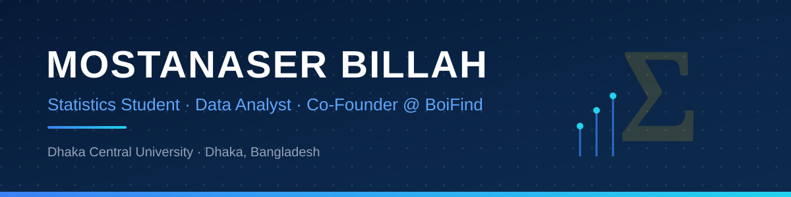

# Mostanaser Billah

**B.Sc. Statistics Student · Data Analyst · Co-Founder @ BoiFind**

---

### 👨‍💻 About Me

- 🎓 First-year **B.Sc. Statistics** student at **Dhaka Central University** (Titumir Campus), Dhaka, Bangladesh
- 🚀 **Co-Founder @ BoiFind** — a live marketplace for buying, selling & exchanging second-hand academic books in Bangladesh
- 💼 **Marketing Event Executive (Part-time)** @ OnnoRokom EdTech
- 📊 I share what I learn in statistics & data — in public — as **#StatisticsInPublic**
- 🌱 Currently learning: Data Analytics, Python, React & Supabase

### 🔭 Currently

- Building **BoiFind** — circular economy for academic books in Bangladesh
- Studying **Statistics, Probability & Linear Algebra** — and turning the concepts into public posts
- Open to **internships & entry-level roles** in data analytics, AI training and web development

---

### 🛠️ Languages & Tools

---

### 🚀 Projects

| Project | What it is | Stack |
|---|---|---|
| **BoiFind** | Live book marketplace — buy, sell & exchange second-hand academic books, with AI-assisted features & delivery | React · TypeScript · Supabase · PostgreSQL |
| **DCU Statistics Website** | Official department website — auth, dashboards, events, alumni directory & student community | React · TypeScript · Supabase |
| **BizPilot AI** | Market research & product workflows for AI-driven e-commerce store management | AI · Data Analysis |
| **21-Day Study System** | Syllabus-based study planner & tracking workbook for Statistics undergraduates | Excel · Google Sheets |

---

### 📊 GitHub Stats

---

### 🤝 Connect with Me

---

> *"We don't just study numbers. We study the future."*

